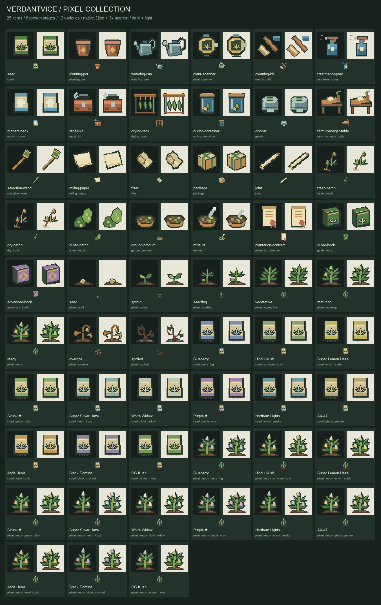
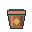
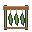
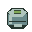
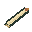
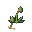
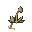
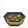
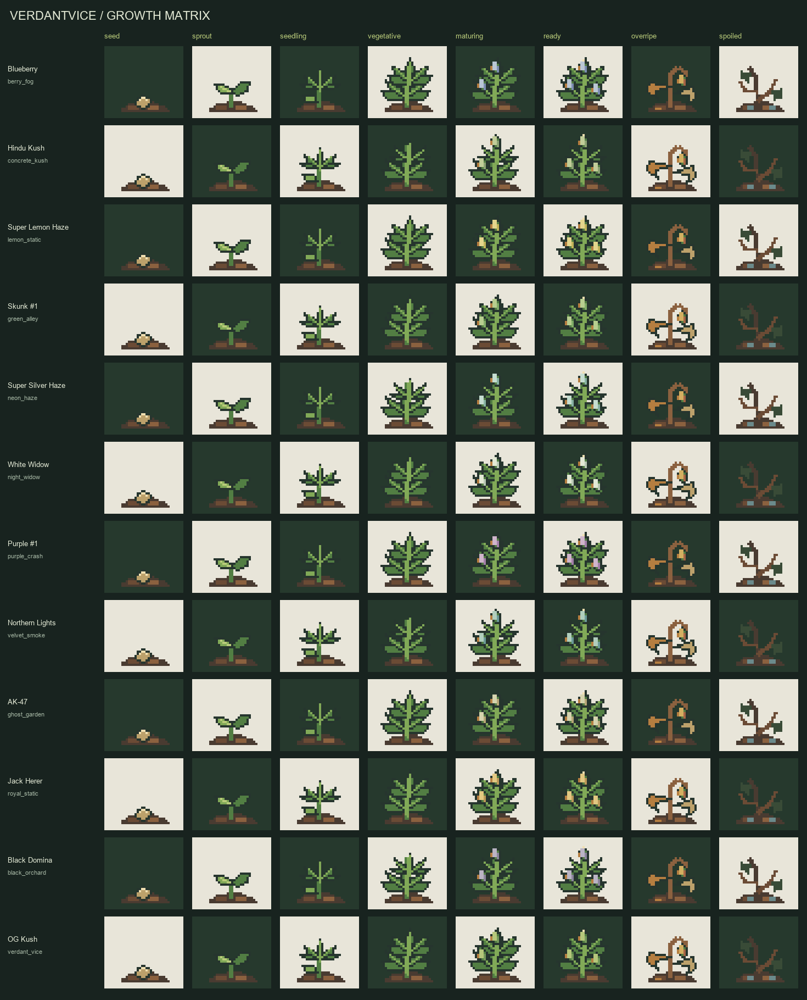

# VerdantVice resource pack

A complete 32×32 pixel-art collection: 25 items, 12 seed packets,
8 generic growth stages, and 96 plant models for 12 strains. Each pack
variant contains **141 textures and 141 models**. Items have distinctive
silhouettes, a limited palette, crisp pixels, and transparent backgrounds.
World plant models consist of two double-sided crossed planes.



## Versions and ready-to-use archives

| Source directory | Minecraft client | Metadata |
|---|---|---|
| `resource-pack/1.21.4/` | 1.21.4 | `pack_format: 46` |
| `resource-pack/26.2/` | 26.2 | `min_format: [88, 0]`, `max_format: [88, 0]` |

The normal build creates both ZIPs. To build only the packs:

```powershell
.\gradlew.bat :verdantvice-paper:resourcePacks
```

Outputs:

- `verdantvice-paper/build/resource-packs/VerdantVice-resourcepack-1.21.4.zip`
- `verdantvice-paper/build/resource-packs/VerdantVice-resourcepack-26.2.zip`

`pack.mcmeta` is at the root of each archive. File ordering and archive
timestamps are fixed, so the same assets produce a reproducible ZIP.
Choose the variant matching the client version. The plugin exposes a single
URL from `resourcepack.yml`; serving different packs to clients using
different protocols requires a proxy-side mechanism.

## All items

The thumbnails below are the exact PNG files used by the game.

| Icon | Item | Configuration ID | CustomModelData |
|---|---|---|---:|
|  | Seeds — generic variant | `seed` | 12001 |
|  | Planting pot | `planting-pot` | 12002 |
|  | Watering can | `watering-can` | 12003 |
|  | Plant scanner | `plant-scanner` | 12004 |
|  | Cleaning kit | `cleaning-kit` | 12005 |
|  | Treatment spray | `treatment-spray` | 12006 |
|  | Nutrient pack | `nutrient-pack` | 12007 |
|  | Repair kit | `repair-kit` | 12008 |
|  | Drying rack | `drying-rack` | 12009 |
|  | Curing container | `curing-container` | 12010 |
|  | Grinder | `grinder` | 12011 |
|  | Farm manager table | `farm-manager-table` | 12012 |
|  | Selection wand | `selection-wand` | 12013 |
|  | Rolling paper | `rolling-paper` | 12014 |
|  | Filter | `filter` | 12015 |
|  | Package | `package` | 12016 |
|  | Finished product | `joint` | 12017 |
|  | Fresh batch | `fresh-batch` | 12018 |
|  | Dried batch | `dry-batch` | 12019 |
|  | Cured batch | `cured-batch` | 12020 |
|  | Ground product | `ground-product` | 12021 |
|  | Mixture | `mixture` | 12022 |
|  | Contract | `plantation-contract` | 12023 |
|  | Guide book | `guide-book` | 12024 |
|  | Advanced guide | `advanced-book` | 12025 |

## Strains

Players see real strain names. Internal identifiers are retained for
compatibility with saved items, plants, and data. The label color, small
packet code, and flower accent distinguish strains in the interface.
The illustrations are stylized game graphics.

| Seeds | Plant | In-game name | Stable ID | Seed model |
|---|---|---|---|---:|
|  |  | Blueberry | `berry_fog` | 13001 |
|  |  | Hindu Kush | `concrete_kush` | 13002 |
|  |  | Super Lemon Haze | `lemon_static` | 13003 |
|  |  | Skunk #1 | `green_alley` | 13004 |
|  |  | Super Silver Haze | `neon_haze` | 13005 |
|  |  | White Widow | `night_widow` | 13006 |
|  |  | Purple #1 | `purple_crash` | 13007 |
|  |  | Northern Lights | `velvet_smoke` | 13008 |
|  |  | AK-47 | `ghost_garden` | 13009 |
|  |  | Jack Herer | `royal_static` | 13010 |
|  |  | Black Domina | `black_orchard` | 13011 |
|  |  | OG Kush | `verdant_vice` | 13012 |

Every strain has eight stages. Generic models use `12101..12108`.
Models for strain index `i` use `13101 + i * 10 + stage`, with zero-based
`i` and stages ordered as `SEED`, `SPROUT`, `SEEDLING`, `VEGETATIVE`,
`MATURING`, `READY`, `OVERRIPE`, and `SPOILED`. Gaps between ranges retain
the vanilla appearance.



## Editing and rebuilding

All final sprites come from `resource-pack/source/pixel_art.py`. It contains
editable shapes on a 32×32 grid and a fixed palette. The generator adds no
noise, blur, or antialiasing. It does not remove dark pixels by guessing the
background color. `catalog.json` is the generated catalog of models and
their numbers.

Requirements: Python 3 and Pillow. Run from the project directory:

```powershell
python -m pip install Pillow
python resource-pack/tools/build_assets.py
python resource-pack/tools/verify_assets.py
```

The generator rebuilds both variants, the catalog, models, item definitions,
pack icons, and both preview sheets. Every texture pixel is fully transparent
or fully opaque. Previews show the art at native resolution and integer
nearest-neighbor enlargement.

`source/plant-concept.png` is a silhouette reference. The old
`source/verdantvice-atlas.png` is retained as historical material; the
generator does not use it. The visual direction is documented in
[art-direction.md](resource-pack/source/art-direction.md).

After changing a model or material, maintain consistency between `items.yml`,
`ResourcePackModels`, the art source, and both packs. For seeds, the base
model `12001` allows the factory to select a strain variant. A custom model
number explicitly set in the configuration is respected.

## Automated checks

`verify_assets.py` compares generated files with the editable source. It
checks completeness, dimensions, palette, alpha, padding, plant geometry,
number mappings, metadata, previews, and consistency between both versions.

`ResourcePackAssetsTest` runs with the normal Gradle tests and does not
require Python. It checks all 282 textures across both versions, consistency
with the plugin's actual model selector and configuration, icon uniqueness,
all stages, and every integer model number through 13299, including vanilla
fallback after every reserved range. `verifyDistribution` additionally
checks the contents of the finished ZIPs.

Vanilla fallbacks preserve the complete item definition from the matching
official client, including block model paths and dynamic clock, brush,
bundle, and decorated-pot rendering. The small checked-in references and
their model fingerprints are documented in
[vanilla/README.md](resource-pack/source/vanilla/README.md). Custom assets
remain identical across pack variants; version-specific native item
definitions may legitimately differ. Tests compare fallbacks to these
native trees rather than assuming `minecraft:item/<material>` exists.

```powershell
.\gradlew.bat :verdantvice-paper:test --tests com.verdantvice.resourcepack.ResourcePackAssetsTest
.\gradlew.bat :verdantvice-paper:verifyDistribution
```

The pack uses three Minecraft sound events. It contains no new audio files;
Polish and English subtitles are in `assets/verdantvice/lang/`.
Aliases use `type: event` and event IDs verified against both official asset
indexes, preserving the native sound choices, pitch, and volume.

## Sending the pack to players

Host the appropriate ZIP at a direct public HTTPS URL that returns the file,
then calculate the SHA-1 of that exact archive:

```powershell
(Get-FileHash .\verdantvice-paper\build\resource-packs\VerdantVice-resourcepack-26.2.zip -Algorithm SHA1).Hash.ToLowerInvariant()
```

Enter your URL and the resulting hash in
`plugins/VerdantVice/resourcepack.yml`:

```yaml
enabled: true
send-on-join: true
required: false
url: "https://cdn.example.net/minecraft/VerdantVice-resourcepack-26.2.zip"
sha1: "0123456789abcdef0123456789abcdef01234567"
prompt-key: resourcepack.prompt
fallback-without-pack: true
```

The URL and hash above are examples. Recalculate the hash after replacing
the ZIP. Then run `/vv admin reload` and `/vv resourcepack`.
`required: true` tells the client that accepting the pack is mandatory.

The pack is optional: items and plants have vanilla materials, so gameplay
remains available without it. `fallback-without-pack` does not select a
separate runtime path. Download problems are covered in
[TROUBLESHOOTING.md](TROUBLESHOOTING.md).

Asset and server tests do not render the Minecraft client. For releases on
a new client version, in-game visual checks cover item positions, world
plants, inventories, lighting, and the pack acceptance screen.
